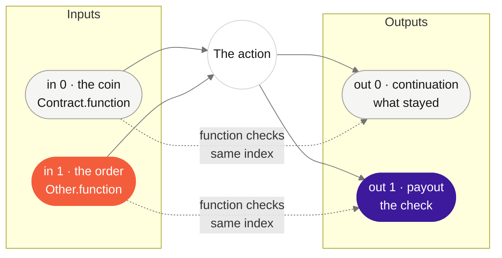

# Draw the covenant

Run this after `writing-arkade-contracts` and before `arkade-contract`. The `.ark` file is already written. Read that file and write the README. Regenerate it when the file changes, in the same commit.

The shape is the [solver-vault](https://github.com/ArkLabsHQ/solver-vault#transactions) page: an opening, Contracts, Functions, then Transactions. Each transaction is one picture.

## The README

The deliverable is the app README, in this order. There is no second set of pictures beside Transactions.

The opening is a few short paragraphs. Name each coin and which transaction spends it. Say which transaction does not spend which coin. A signature that lands on an output, and a later transaction that only reads that output, are two transactions. The later function's arguments are not that signature.

State a formula only when the `.ark` file writes it, with the constants from that file. Carrier is 330 sats. A direct send to an address is a second coin. Only a spend that pays the continuation script changes the position the contract tracks. Do not draw the direct send as its own picture. Name the `.ark` paths these transactions spend.

Where more than one owner needs a way out and that set is not named in the contract, `exit` is PULSE. One owner keeps that key on the leaf.

### Contracts

One `###` per contract. The constructor signature, then this table. Parameters that are one asset id share a row. A sentence after the table only when the next coin spends this continuation.

| Parameter | Bound as |
| --- | --- |
| `name` | What that parameter fixes on this coin. |

### Functions

Open with: A `require` checks the transaction. It does not identify who may move the coins.

One `###` per contract. Each function is a signature line and a short list. Do not draw a separate picture of who signs.

**name**(args) `covenant`

**name**(args) `tapscript`

**exit** `PULSE`

The first sentence says which transaction this runs in and who signs.

- A covenant function with no matching tapscript is the server plus the function-tweaked emulator. The operator cosigns. Anyone who can build that transaction can pass the `require`. Say when a person does not sign.
- A tapscript names the keys on the leaf. The receiver spending the script they named when they took the coins is the signature, as `OptionIntent` does.
- One owner: `exit` is that key after `older(serverExitDelay)`, on the published output.
- PULSE: the contract does not name the set. The leaf is `older(serverExitDelay)` and `checkSig(pulseSig, pulseKey)`. `pulseSig` is already on the lattice root. `pulseKey` is deleted after that tree is signed. Publishing the path from the batch output to this coin, then that owner's branch, is that owner's exit. Write PULSE only when the contract is that shape.

The list is the checks, in source order. Show the comparison the script writes. An output the script does not pin is unconstrained. Every output the function checks is in the Transactions picture. The picture does not drop one.

Close Functions with two lines. Enforced: the checks these transactions turned on. Not claimed: oracle honesty, liveness, and a destination the script does not pin.

### Transactions

One `###` per action, in the order they happen. The heading is the action. Funding is its own transaction. A function that only runs inside another transaction is an input of that picture, not its own heading. A transaction that must happen before another is its own heading. Exit is its own heading. The spend the script refuses is the last picture. It is not a step in the protocol.

The prose before the picture names `Contract.function` on each input, says what is not an input, and says what moves. A few short sentences.

The picture is this shape. `flowchart LR`. An Inputs subgraph, the circle, an Outputs subgraph. Both subgraphs are `direction TB`. The titles are `Inputs` and `Outputs`. Every input links to the circle. The circle links to every output. Copy the four `classDef`s and the `linkStyle` into every picture. The words below are placeholders. The README uses the names from the `.ark` file.

- Stadium `([...])` for a coin a contract names. Rectangle `["..."]` for a person's unbound coins and for change. Circle `((...))` for the transaction. The circle is the action, two lines at most.
- A funding picture is rectangles for `in 0…` and for change, a stadium for the new coin, and no dotted edge. Change says `when there is any`. A covenant picture draws a change output only when the function counts one.
- Labels are `in N · role` and `out N · role`. A run of the same unbound inputs is `in 0…`. The function is the next line of a contract input. Break a label with ` `. The middle dot is `·`.
- A dotted edge only when that input's script checks that output. The label names the function and `same index`, or the check in the words the script writes. Omit the edge when the script does not write that check.
- `entry` (`#f45d3c`, white text) is a coin a person spends into this transaction. When no person is paying in, `entry` is the subject input of the heading.
- `accent` (`#3d1a9b`, white text) is an output a person receives, or a coin this transaction creates for a later one to read.
- `muted` is a continuation of an input, change, and an input that is context for the subject.
- Node ids stay short (`I0`, `TX`, `O0`). The label carries the index.
- A presigned lattice names the pool output, the lattice root, and one slot per member. It does not invent indexes the script does not have.
- The refused picture uses this same shape. The circle says `rejected` and the `require` that fails: the deadline already passed, a second copy of the same script, an output the function does not name. The prose says the picture may fail to balance. Leave the failing outputs as they are.

## Amounts

Amounts that are not in the `.ark` file do not appear. 330 sats is the carrier. The pot is the sats above it. A constructor parameter is drawn under its name (`amount`, `collateral`, `premium`). A sample from a test, a fixture, or `/v1/info` is not a number in the README.

Show the comparison the script writes. A `>=` check is not `sats in = out`. An output the script does not pin is labeled unconstrained. An asset moves in the same units. Draw an extension output only when the contract reads `tx.packet`, and the anchor only when a control asset continues. Neither gets a sat amount.

A formula the file writes goes in the opening. A price-function section is a further section, and only when the script reads a public number. Escrow pays the committed `amount`, so it has neither.

## Examples

Learn the page from [solver-vault](https://github.com/ArkLabsHQ/solver-vault#transactions). Learn what one contract draws from escrow and one standing offer, then write the contract in this commit.

Escrow is `compiler/examples/escrow/escrow.ark`. Party A sends the coin. `complete` pays `partyBScript` at least `amount`, and a surplus above 330 to `partyAScript`. `cancel` returns the coin after `checkTime(timeoutAt)`. The oracle signs the committed message. `complete` and `cancel` are the server plus the function-tweaked emulator. `unilateral` is party A and party B after `older(serverExitDelay)`. The transactions are the funding, `complete`, `cancel`, the exit, and one rejected spend.

One standing offer is `compiler/examples/option/option_intent.ark`, or the pot. OptionIntent names `collateral`, `premium`, and `DUST` (330). The funder does not sign `finalize`. That spend takes this coin plus one input whose script is not this intent, and pays the scripts the constructor already named. The pot is the standing offer with no other amounts in the file: carrier 330, pot above it. Draw the one this contract is.

## Options

Fares, dust kinks, and oracle prices stay in the options example, [arkade-options](https://github.com/ArkLabsHQ/arkade-options) (`contracts/option_vault.ark`, `viz/index.html`). Leave them out of escrow and the pot.

That vault reads a public price and pays from it, so the price-function section belongs there. State the formula the file writes. The dust kink is the price where a leg falls to 330 and the output count changes. The protocol fare is the operator's charge. It is not the premium. In that file, `pot` means locked value minus `readFee`. Here the pot is the sats above the 330-sat carrier.

The interactive page is that options case. The control sets the public number the script reads and calls the same function the tests use. Show that number next to the settlement it produced. The control cannot show a payment the formula does not produce. Draw another settlement only when the fold changes how many outputs there are.

## Check

The README, the `.ark` file, and the artifact are in one commit. The order is opening, Contracts, Functions, Transactions. Every transaction picture has Inputs, the circle, and Outputs, the four classes, and the grey links. A dotted edge is a check the script writes. Every output the function checks is in the picture. Every satoshi amount is 330 or a literal in the `.ark` file. The opening says a direct send is a second coin, and no picture treats that send as the continuation. The rejected picture stays rejected, and it is last. Functions state that a `require` is not authorization, and a covenant with no tapscript is the server plus the function-tweaked emulator. There is no price-function section unless the script reads a public number, and no interactive page unless that number changes the payment.

Then spend the artifact with `arkade-contract`. The screen follows the transaction this README draws for the current coin and shows one next action. It does not invent a second protocol.
